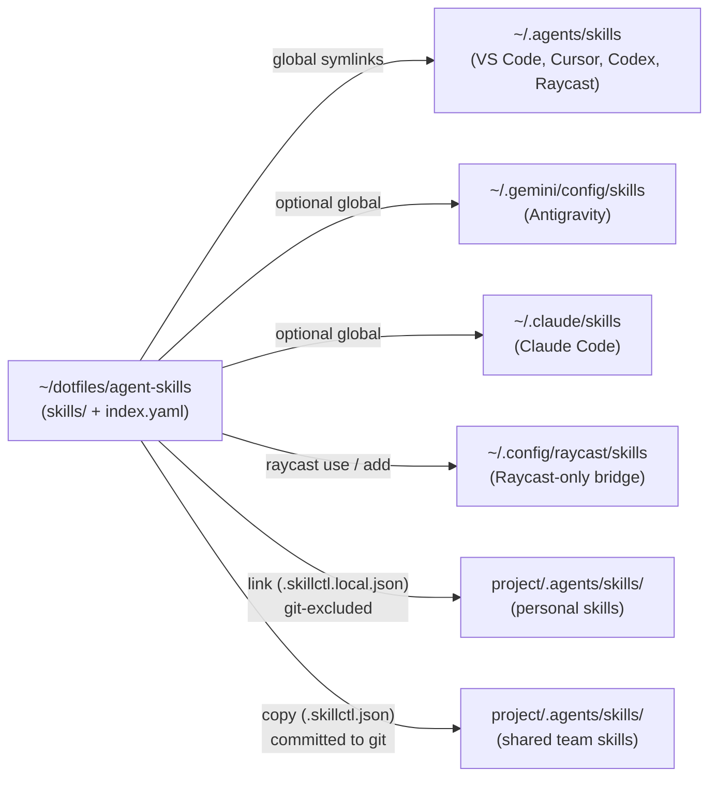

<div align="center">

# ◆ skillctl

**Manage global, per-project, and Raycast AI agent skills from one central library.**

[](./LICENSE)
[](https://nodejs.org/)
[](https://www.typescriptlang.org/)
[](#requirements--environments)

Works across **VS Code (Copilot)**, **Cursor**, **Raycast**, **Antigravity**, and **T3 Code (Codex + Claude Code)**.

[Website & Docs](https://rogreyroom.github.io/skillctl/)

</div>

---

## How It Works



## Features

- **Central skill library** (`~/dotfiles/agent-skills` by default, configurable via `skillctl setup`) with project-matching rules kept in `index.yaml` so `SKILL.md` stays untouched and Raycast-compatible.
- **Smart project detection (`skillctl init`)** — scans `package.json`, `composer.json`, `pyproject.toml`, `Cargo.toml`, and config files (`nuxt.config.*`, `wrangler.toml`, `.gitlab-ci.yml`, etc.) to suggest matching skills.
- **Mixed personal & team/repo skills** — split cleanly between `.skillctl.local.json` (personal symlinks, auto-excluded via `.git/info/exclude`) and `.skillctl.json` (shared `copy` mode, committed for teammates & CI with hash-based drift detection).
- **Capture existing project skills** — `skillctl init` detects skills already inside `.agents/skills/`, `.claude/skills/`, or `.cursor/skills/` that aren't in your library yet, lets you save them to your library, and lets you decide whether they stay in the repo, become personal symlinks, or are removed from the project.
- **Raycast bridge (`~/.config/raycast/skills`)** — expose an active project's skills (`skillctl raycast use`) or pin specific skills (`skillctl raycast add`) to Raycast without polluting `~/.agents/skills` for Cursor, VS Code, or Codex.
- **Bidirectional duplicate checks** — prevents or warns on overlap between global and project skills in both directions.
- **Health checks (`skillctl doctor --fix`)** — finds and repairs broken symlinks, global/project/Raycast duplicates, invalid `SKILL.md` files (kebab-case / name mismatch), and drifted copied skills.
- **Import & Migrate** — install remote skills from GitHub (`skillctl install owner/repo`) or migrate existing skills from `~/.agents/skills`, `~/.claude/skills`, `~/.cursor/skills`, and `~/.codegpt/skills`.

## Requirements & Environments

- **Node.js** `>= 20`
- **pnpm** (or `npm`)
- **git** (optional, needed for `skillctl install <repo>` and `.git/info/exclude` integration)

### macOS
Full support for all agents and commands, including the Raycast bridge (`~/.config/raycast/skills`).

### Linux
Full support for VS Code, Cursor, Codex, and Claude Code (`~/.agents/skills`, `~/.claude/skills`, `.agents/skills`, `.claude/skills`). Raycast is not available on Linux, so `skillctl raycast` subcommands are simply unused.

### Windows Subsystem for Linux (WSL)
Works out of the box inside WSL with Node 20+:
- **Recommended:** Keep your library (`~/dotfiles/agent-skills`) and git repositories inside the **WSL Linux filesystem** (`~/projects/...`), where symlinks work natively and fast.
- **Windows drive (`/mnt/c/...`):** Creating symlinks on DrvFs requires **Windows Developer Mode** enabled (or elevated permissions). If you don't want to enable Developer Mode for repos on `/mnt/c/...`, use `--copy` mode instead.
- As on Linux, `skillctl raycast` subcommands are not used inside WSL.

## Installation

```bash
git clone https://github.com/rogreyroom/skillctl.git
cd skillctl
pnpm install
pnpm build
npm link
```

Verify the install:

```bash
skillctl --help
```

## Quick Start

```bash
# 1. Configure library path (default ~/dotfiles/agent-skills) & optionally migrate existing skills
skillctl setup

# 2. Pick global skills (linked into ~/.agents/skills, and ~/.claude/skills if enabled)
skillctl global add

# 3. Inside any project, detect stack, capture unknown project skills, and link/copy matches
cd /path/to/your-project
skillctl init

# 4. (macOS) Expose the current project's skills to Raycast via ~/.config/raycast/skills
skillctl raycast use

# 5. Check health and auto-fix stale links, duplicates, or drifted copies
skillctl doctor --fix
```

### Setting Up on a Second Machine (macOS / Linux / WSL)

If your library (`~/dotfiles/agent-skills`) is a git repo:

```bash
git clone <your-dotfiles-repo> ~/dotfiles
skillctl setup --yes --library ~/dotfiles/agent-skills
skillctl global sync
```

Then in any cloned project:

```bash
skillctl sync   # restores skills from .skillctl.json / .skillctl.local.json
```

## Personal vs. Repo-Committed Project Skills

You can mix personal and team-shared skills in the same repository:

| Scope | Manifest | Mode | Git Behavior |
|---|---|---|---|
| **Personal** | `.skillctl.local.json` | `link` (symlink to library) | Automatically added to `.git/info/exclude` — `git status` stays clean |
| **Shared / Team** | `.skillctl.json` | `copy` (real files) | Committed to git so teammates and CI get the skills |

- `skillctl init` offers **All personal**, **All shared in repo**, or **Mixed**.
- `skillctl add <skill>` (or `--link`) adds a personal symlink to `.skillctl.local.json`.
- `skillctl add <skill> --copy` adds a committed copy to `.skillctl.json`.

## Command Reference

Run `skillctl --help` or `skillctl <command> --help` for all flags.

| Command | Description |
|---|---|
| `skillctl setup` | Configure library path, toggle Claude Code & Antigravity targets, and migrate existing skills |
| `skillctl status` | Show library path, enabled targets, global/project skill counts, worktree state, and Raycast bridge |
| `skillctl init` | Scan project, capture unknown local skills, suggest matches, and sync |
| `skillctl add [skills...]` | Add skill(s) to current project (`--link` personal / `--copy` shared) |
| `skillctl rm [skills...]` | Remove skill(s) from current project |
| `skillctl sync` | Rebuild symlinks/copies from `.skillctl.json` and `.skillctl.local.json` (`--all` for all tracked projects; auto-inherits local manifest in git worktrees) |
| `skillctl list` (`ls`) | List all library skills (`-p, --project` to show only skills active in the current project) |
| `skillctl new <name>` | Scaffold a new kebab-case skill with Raycast-valid `SKILL.md` frontmatter and optional match rules |
| `skillctl edit [skill]` | Open a skill's `SKILL.md` in `$EDITOR` and validate frontmatter on save |
| `skillctl search <query>` | Search library skills by name, description, `@group`, or match rules |
| `skillctl info <skill>` | Show metadata, rules, upstream source, and tracked project usage for a skill |
| `skillctl group list\|add\|rm` | Create and manage `@group` bundles in `index.yaml` |
| `skillctl global list\|add\|rm\|sync` | Manage global skills in `~/.agents/skills` (plus `~/.claude/skills` and `~/.gemini/config/skills` if enabled) |
| `skillctl raycast use\|clear\|add\|rm\|status` | Switch active project or pin skills in `~/.config/raycast/skills` (macOS) |
| `skillctl install <source>` | Import skill(s) from GitHub (`owner/repo`, git URL) or a local folder into library (records upstream `source`) |
| `skillctl update [skills...]` | Re-pull installed skill(s) from their recorded upstream source in `index.yaml` |
| `skillctl migrate` | Import existing skills from `~/.agents/skills`, `~/.claude/skills`, `~/.cursor/skills`, `~/.codegpt/skills` |
| `skillctl doctor [--fix]` | Check/repair broken symlinks, duplicates, legacy `~/.cursor/skills` copies, invalid `SKILL.md`, and copy drift |
| `skillctl completion <zsh\|bash\|fish>` | Print dynamic shell autocompletion script for subcommands, skills, and `@groups` |

## Library Layout & `index.yaml`

```text
~/dotfiles/agent-skills/
├── index.yaml
└── skills/
    ├── find-skills/
    │   └── SKILL.md
    ├── vitest/
    │   └── SKILL.md
    └── nuxt-api-development/
        └── SKILL.md
```

Each skill folder must use **kebab-case** and match the `name` field in its `SKILL.md` YAML frontmatter (required by Raycast; checked by `skillctl doctor`).

Example `index.yaml`:

```yaml
global:
  - find-skills

groups:
  nuxt:
    - nuxt-api-development
    - nuxt-component-development
    - drizzle-migration-review

skills:
  vitest:
    match:
      deps: [vitest]
      files: [vitest.config.*]
  nuxt-api-development:
    match:
      deps: [nuxt]
      files: [nuxt.config.*]
  drizzle-migration-review:
    match:
      deps: [drizzle-orm, drizzle-kit]
      files: [drizzle.config.*]
  laravel-api:
    match:
      files: [composer.json, artisan]
```

Use groups anywhere skills are accepted (e.g. `skillctl add @nuxt`, `skillctl rm @nuxt`, `skillctl raycast add @nuxt`).

## Development

```bash
pnpm build       # compile TypeScript to dist/
pnpm test        # run Vitest test suite
pnpm typecheck   # type-check without emitting
```

## License

[MIT](./LICENSE)
